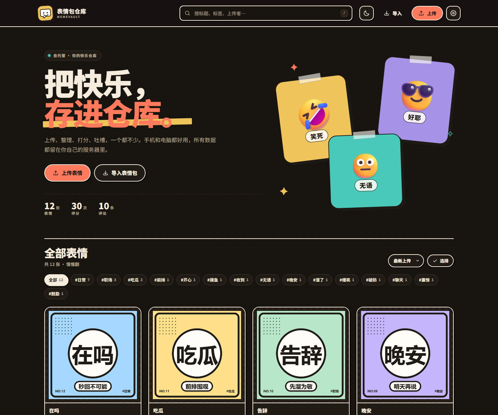
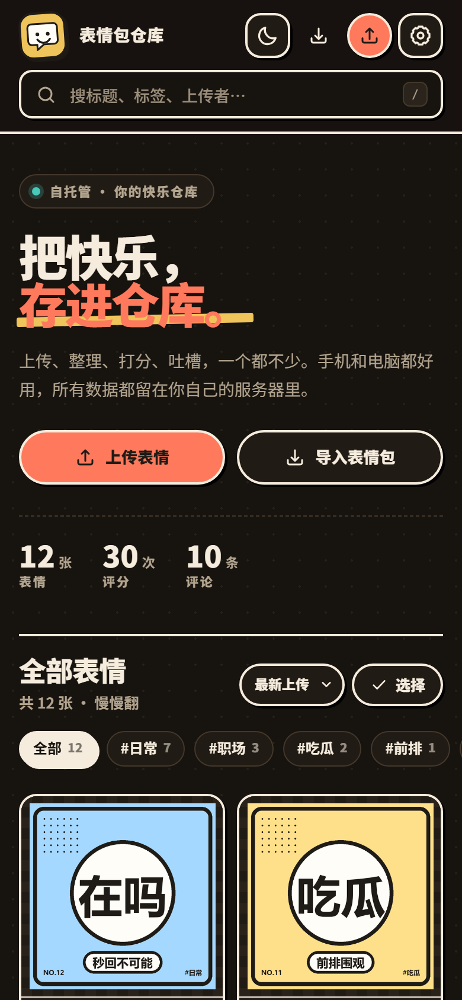
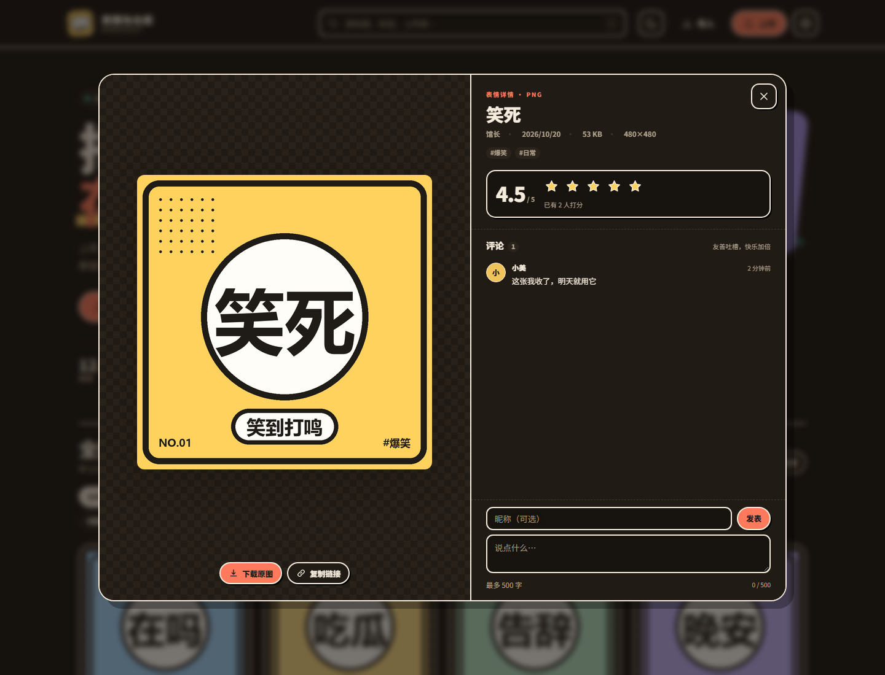
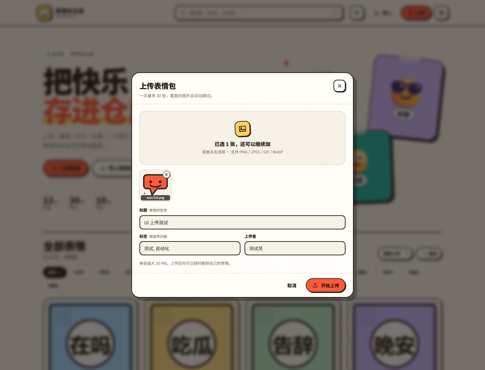
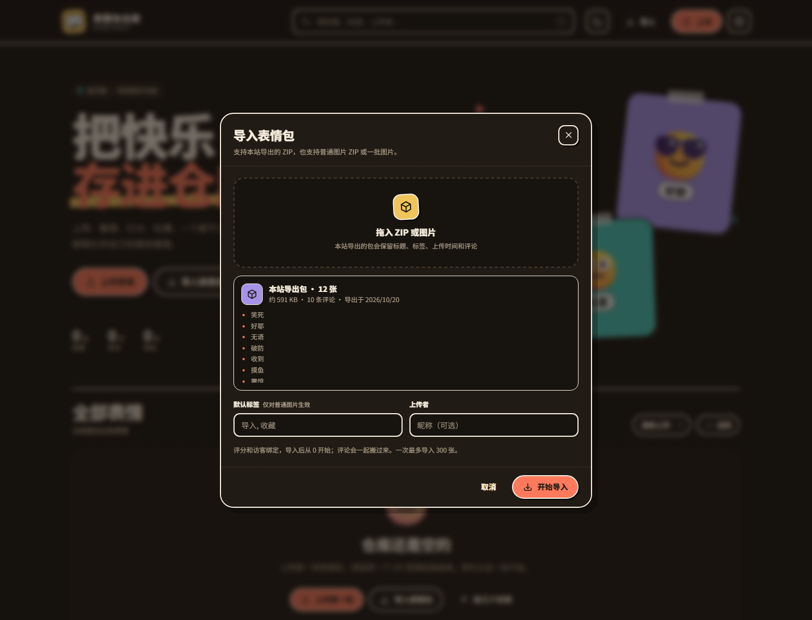

# 表情包仓库 MemeVault

一个可以自己托管的表情包网站：上传、导入、导出、评分、评论，手机和电脑都能用。数据全部留在你自己的服务器上，不需要第三方账号，也没有广告和追踪。



| 手机端 | 表情详情 |
| --- | --- |
|  |  |

## 功能

- **上传**：拖拽、点击选择或直接粘贴图片，支持 PNG / JPEG / GIF / WebP，一次最多 30 张；服务端按文件头校验真实格式，拒绝 SVG，重复图片自动跳过。
- **导入**：支持本站导出的 ZIP，也支持装着普通图片的 ZIP 或一批图片。本站导出包会保留标题、标签、上传者、上传时间和评论；评分与访客绑定，导入后重新开始。
- **导出**：一键导出全部，或在选择模式下勾选多张导出。ZIP 内包含 `manifest.json`、`README.txt` 和原图，可再次导回本站。
- **评论**：详情页直接评论，管理员可以删除评论。
- **评分**：5 星评分，同一访客可改分；按设备本地访客 ID 区分，不做账号系统。
- **浏览**：关键词搜索、标签筛选、最新/最热/评分排序、分页加载。
- **分享**：每张表情都有 `#m/<id>` 深链，复制链接可直接打开详情。
- **响应式**：桌面双栏详情、手机全屏单栏；手机底部抽屉式弹窗，适配安全区。
- **主题**：亮色 / 暗色主题，自动跟随系统，也可手动切换并记住选择。
- **PWA**：带 Web App Manifest 和图标，可以添加到手机主屏幕。
- **自托管**：Node.js 内置 SQLite，图片存本地磁盘，没有外部数据库和云存储依赖。

<p>
  
  
</p>

## 技术栈

- 后端：Node.js 24、原生 `node:http`、`node:sqlite`（Node 内置 SQLite）
- 前端：原生 HTML / CSS / ES Module，无构建步骤、无前端依赖
- 数据库：SQLite（WAL 模式），图片直接存 `DATA_DIR/uploads`
- 浏览器端 ZIP：`DecompressionStream('deflate-raw')`，支持 store / deflate
- 部署：Docker、Docker Compose、Render、Fly.io、任意支持 Node 24 的 VPS

项目**零运行时第三方依赖**，`npm install` 不需要下载任何包。

## 快速开始

要求 **Node.js >= 24**（依赖内置的 `node:sqlite`）。

```bash
npm start
```

打开 <http://localhost:3000>。首次启动会自动创建数据库、上传目录和表结构。

开发模式（文件变动自动重启）：

```bash
npm run dev
```

### 配置

复制示例配置后按需修改：

```bash
cp .env.example .env
```

`npm start` 会自动读取项目根目录的 `.env`。所有配置也可以直接用环境变量传入。

| 变量 | 默认值 | 说明 |
| --- | --- | --- |
| `PORT` | `3000` | 监听端口 |
| `HOST` | `0.0.0.0` | 监听地址 |
| `DATA_DIR` | `./data` | SQLite 与图片的存放目录，**必须持久化** |
| `ADMIN_TOKEN` | 空 | 管理员密钥；留空则只能删除自己上传的表情，也不能删评论 |
| `MAX_UPLOAD_MB` | `10` | 单张图片大小上限 |
| `MAX_BODY_MB` | `64` | 单次请求体上限 |
| `MAX_EXPORT_MB` | `300` | 单次导出 ZIP 上限 |
| `TRUST_PROXY` | `1` | 在反向代理后设为 `1`，以读取 `X-Forwarded-For` |
| `RATE_LIMIT` | `1` | 设为 `0` 关闭内存限流（不建议） |
| `LOG_REQUESTS` | `0` | 设为 `1` 打印请求日志 |

生成一个管理员密钥：

```bash
node -e "console.log(require('crypto').randomBytes(24).toString('hex'))"
```

把结果填到 `.env` 的 `ADMIN_TOKEN`，重启服务；然后在网站右上角「设置」中填入同一个密钥即可解锁管理操作。

> 管理密钥只保存在浏览器 `sessionStorage`，关闭标签页即失效。它不会出现在导出包中。

## 部署

### Docker

```bash
docker build -t memevault .
docker run -d \
  --name memevault \
  -p 3000:3000 \
  -v memevault-data:/app/data \
  -e ADMIN_TOKEN="换成你自己的随机密钥" \
  --restart unless-stopped \
  memevault
```

访问 <http://localhost:3000>。`/app/data` 是持久化卷，删容器不会丢数据。

### Docker Compose

```bash
ADMIN_TOKEN="换成你自己的随机密钥" docker compose up -d --build
```

数据库和图片保存在命名卷 `memevault-data` 中。

### Render

仓库里的 `render.yaml` 是一个 Render Blueprint：

1. 把代码推到 GitHub。
2. 在 Render 新建 **Blueprint**，选择该仓库。
3. Render 会按 `render.yaml` 构建 Docker 镜像、挂载 1 GB 持久磁盘到 `/app/data`，并自动生成 `ADMIN_TOKEN`。
4. 部署完成后在服务的 **Environment** 页面查看自动生成的 `ADMIN_TOKEN`。

免费实例的本地磁盘不持久，务必使用带持久磁盘的实例类型（蓝图默认 `starter`）。

### Fly.io

```bash
fly launch --no-deploy       # 按提示改成全球唯一的 app 名
fly volumes create memevault_data --size 1
fly secrets set ADMIN_TOKEN="换成你自己的随机密钥"
fly deploy
```

`fly.toml` 已配置 Singapore 区域、256 MB 内存和挂载到 `/app/data` 的卷。若改应用名，同时修改 `fly.toml` 里的 `app`。

### GitHub

GitHub 在本项目中承担三件事：

1. **源码托管**：推送仓库即可。
2. **CI**：`.github/workflows/ci.yml` 在每次 push / PR 时用 Node 24 跑语法检查和 11 项自动化测试。
3. **镜像发布**：`.github/workflows/docker-publish.yml` 在 push 到 `main`、打 `v*` 标签或手动触发时，构建 `linux/amd64` + `linux/arm64` 镜像并推送到 GHCR：

   ```bash
   docker pull ghcr.io/<你的GitHub用户名>/memevault:latest
   ```

   首次发布后，到 GitHub 仓库的 **Packages** 设置里把镜像可见性改成 public，或者先 `docker login ghcr.io` 再拉取。

> **不能只用 GitHub Pages 托管完整站点。** Pages 只能放静态文件，无法运行 Node 服务、SQLite 和上传接口。前端虽然可以静态打开，但上传、导入、评论、评分、导出都会失效。请使用上面任一支持容器的平台。

### 自己的一台 VPS

```bash
git clone <你的仓库地址> memevault
cd memevault
npm start
```

生产环境建议用 systemd 守护，并在前面放 Nginx / Caddy 处理 HTTPS：

```nginx
server {
    listen 443 ssl http2;
    server_name memes.example.com;

    client_max_body_size 80m;

    location / {
        proxy_pass http://127.0.0.1:3000;
        proxy_set_header Host $host;
        proxy_set_header X-Forwarded-For $proxy_add_x_forwarded_for;
        proxy_set_header X-Forwarded-Proto $scheme;
    }
}
```

同时设置 `TRUST_PROXY=1`。HTTPS 是浏览器剪贴板、PWA 安装等能力正常工作的前提。

## 备份与迁移

所有持久数据都在 `DATA_DIR`（默认 `./data`；Docker 中是 `/app/data`）：

```
data/
├── memevault.db        # SQLite 数据库（另有 -wal / -shm）
└── uploads/            # 原始图片
```

备份时先停止服务，复制整个 `data/` 目录即可；恢复时放回同一路径再启动。Docker 下可以：

```bash
docker compose stop
docker run --rm -v memevault-data:/data -v "$PWD:/backup" alpine \
  tar czf /backup/memevault-backup.tar.gz -C /data .
docker compose start
```

## 使用说明

### 导入格式

本站导出的 ZIP 结构：

```
manifest.json
README.txt
memes/
  <表情 id>.<png|jpg|gif|webp>
```

`manifest.json` 的 `format` 为 `memepack/v1`，每一项包含 `file`、`title`、`tags`、`uploader`、`createdAt` 和 `comments`。导入时会按 `file` 找到对应图片并恢复这些字段。

普通 ZIP 会扫描其中的 PNG / JPEG / GIF / WebP 图片；标题取文件名，标签使用导入对话框中填写的默认标签。也可以直接选择多张图片导入。

### 评分与访客

- 评分以浏览器里的随机访客 ID 为键，同一设备可随时改分，换设备/清空本地存储后视为新访客。
- 卡片和详情页显示平均分与参与人数。
- **导出包只包含评分统计，不包含每个访客的评分记录**；导入到新站点后评分从 0 开始，避免把旧访客 ID 带过去。评论会正常保留。

### 删除权限

- 上传者在当前浏览器会拿到一个删除令牌（存在 `localStorage`），可删除自己上传的表情。
- 设置 `ADMIN_TOKEN` 并登录后，管理员可以删除任意表情和任意评论。
- 删除表情会级联删除它的评分和评论。

## 项目结构

```
memevault/
├── src/
│   ├── server.js       # 启动、.env 加载、优雅关闭
│   ├── app.js          # HTTP 路由、静态文件、安全头、限流
│   ├── store.js        # 表情/评分/评论/导入导出
│   ├── db.js           # SQLite 建表与事务
│   ├── images.js       # 图片格式嗅探、哈希、尺寸校验
│   ├── zip.js          # 服务端 ZIP 生成
│   ├── text.js         # 文本、标签、访客 ID 清洗
│   ├── errors.js       # 统一 HTTP 错误
│   └── config.js       # 环境变量与路径
├── public/
│   ├── index.html      # 单页界面
│   ├── styles.css      # 设计系统与响应式
│   ├── app.js          # 前端逻辑
│   ├── zip.js          # 浏览器端 ZIP 解析
│   ├── theme.js        # 防闪烁主题初始化
│   └── ...             # 图标、manifest
├── tests/              # node:test API 测试
├── docs/               # 截图
├── Dockerfile
├── docker-compose.yml
├── render.yaml
├── fly.toml
└── .github/workflows/  # CI + GHCR 镜像发布
```

## API

所有响应均为 JSON（导出接口返回 ZIP）。错误格式：

```json
{ "error": { "code": "invalid_request", "message": "..." } }
```

| 方法 | 路径 | 说明 |
| --- | --- | --- |
| `GET` | `/api/health` | 健康检查 |
| `GET` | `/api/config` | 前端需要的上限与版本 |
| `GET` | `/api/stats` | 表情/评论/评分总数、总字节、标签统计 |
| `GET` | `/api/memes` | 列表；`q`、`tag`、`sort=new\|hot\|rating`、`page`、`limit` |
| `POST` | `/api/memes` | 上传，body `{ files:[{filename,title,tags,dataUrl}], tags, uploader }` |
| `GET` | `/api/memes/:id` | 详情；`?visitor=` 返回该访客评分 |
| `DELETE` | `/api/memes/:id` | 删除；请求头 `x-delete-token` 或 `x-admin-token` |
| `POST` | `/api/memes/:id/rating` | 评分，body `{ visitor, value: 1..5 }` |
| `GET` | `/api/memes/:id/comments` | 评论列表 |
| `POST` | `/api/memes/:id/comments` | 发评论，body `{ author, body }` |
| `DELETE` | `/api/comments/:id` | 删除评论，需要 `x-admin-token` |
| `POST` | `/api/import` | 导入，body `{ memes:[{filename,title,tags,uploader,createdAt,comments,dataUrl}] }` |
| `GET` | `/api/export?ids=all` | 导出全部；也可用逗号分隔的 id 列表 |
| `GET` | `/api/admin/check` | 校验 `x-admin-token` |

示例：

```bash
curl -s http://localhost:3000/api/stats

curl -s -X POST http://localhost:3000/api/memes/00000000-0000-0000-0000-000000000000/rating \
  -H 'content-type: application/json' \
  -d '{"visitor":"visitor_12345678","value":5}'

curl -OJ 'http://localhost:3000/api/export?ids=all'
```

## 安全与限制

- 服务端按文件头识别图片，不信任扩展名；SVG 会被拒绝，避免脚本注入。
- 所有页面响应带 CSP、`X-Content-Type-Options`、`Referrer-Policy` 等安全头；上传内容通过 `/media/` 以原始图片 MIME 提供。
- 内存限流按 IP 限制上传、导入、评论、评分、导出频率；多实例部署时每个实例独立计数。
- 默认没有账号系统，上传和评论是公开的。**公开部署前请考虑**：设置强 `ADMIN_TOKEN`、按需调整限流、定期备份；如果面向完全开放的公网，建议在前面加一层访问控制或对象存储 + 审核流程。
- 单进程 SQLite 适合个人/小团队。多实例横向扩展需要把 SQLite 换成共享数据库，并把图片放到共享存储。

## 测试

```bash
npm test
```

覆盖健康检查、上传与格式拒绝、重复去重、搜索/标签/排序、评分、评论、ZIP 导出、导入保留元数据与去重、删除权限、参数校验和首页静态资源，共 11 项。

前端已用无头 Edge 在 1440px 桌面和 390px 手机视口做过页面、详情、上传、导入、评分、评论、批量导出和主题切换验证。

## License

[MIT](LICENSE)
